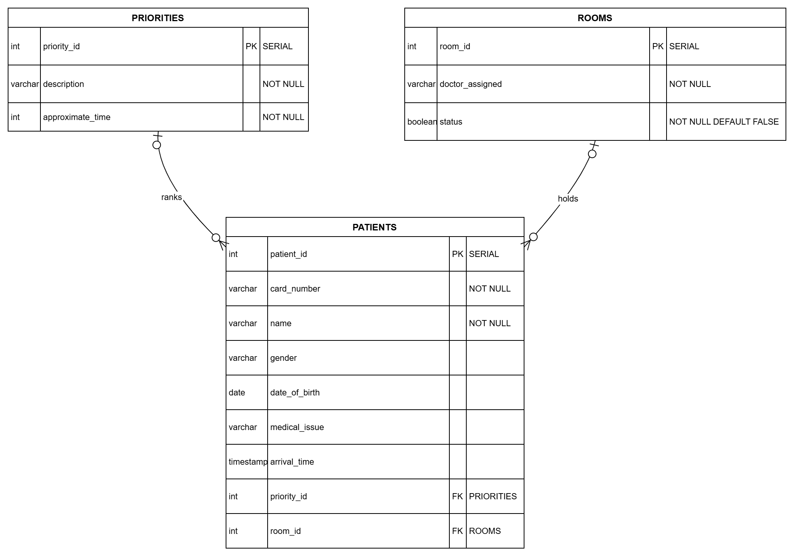

# Hospital Triage Database Design

This document describes the database for the Hospital Triage app. The database is named `emergency_waitlist`. It has three entities: **Patients**, **Priorities**, and **Rooms**.

## 1. Entities

### Patients
Stores each person waiting for care. It keeps their identification (health card number and name), basic personal details, the reason for their visit, and when they arrived. Each patient is linked to one priority level and, once one is free, one room.

### Priorities
Stores the urgency levels used to sort the waitlist (for example High, Medium, Low). Each level has an approximate waiting time, so staff know how long a patient at that level should expect to wait.

### Rooms
Stores the treatment rooms in the emergency department. Each room records the doctor assigned to it and whether it is currently occupied or available.

## 2. Attributes

### Patients
| Attribute | Data Type | Constraints | Description |
|---|---|---|---|
| patient_id | SERIAL (integer) | PRIMARY KEY | Unique number for each patient, created automatically |
| card_number | VARCHAR(255) | NOT NULL | Health card number used to identify the patient |
| name | VARCHAR(255) | NOT NULL | Patient's full name |
| gender | VARCHAR(50) | | Patient's gender |
| date_of_birth | DATE | | Patient's date of birth |
| medical_issue | VARCHAR(255) | | Reason for the visit (e.g. Headache) |
| arrival_time | TIMESTAMP | | Date and time the patient arrived |
| priority_id | INT | FOREIGN KEY → PRIORITIES(priority_id) | The patient's urgency level |
| room_id | INT | FOREIGN KEY → ROOMS(room_id) | The room the patient is assigned to, if any |

### Priorities
| Attribute | Data Type | Constraints | Description |
|---|---|---|---|
| priority_id | SERIAL (integer) | PRIMARY KEY | Unique number for each priority level |
| description | VARCHAR(255) | NOT NULL | Name of the level (High, Medium, Low) |
| approximate_time | INT | NOT NULL | Expected wait in minutes |

### Rooms
| Attribute | Data Type | Constraints | Description |
|---|---|---|---|
| room_id | SERIAL (integer) | PRIMARY KEY | Unique number for each room |
| doctor_assigned | VARCHAR(255) | NOT NULL | Doctor responsible for the room |
| status | BOOLEAN | NOT NULL, DEFAULT FALSE | TRUE = occupied, FALSE = available |

## 3. Relationships

The **Patients** table holds two foreign keys, so it is the "many" side of both relationships.

| Relationship | Type | Explanation |
|---|---|---|
| Priorities → Patients | One-to-many | One priority level (e.g. High) can apply to many patients. Each patient has at most one priority, stored in `priority_id`. |
| Rooms → Patients | One-to-many | One room can be assigned to many patients over time. Each patient is in at most one room, stored in `room_id`. The value is empty while the patient is still waiting. |

## 4. Database Schema (ERD)

**How to read the diagram:**
- **PK** marks a primary key and **FK** marks a foreign key.
- Each line connects a foreign key in **Patients** to the primary key it points to.
- The crow's foot (three prongs) sits on the **Patients** end of each line, meaning "many."
- The single bar on the **Priorities** and **Rooms** ends means "one."
- The circle means "optional": a patient can be listed before a room is assigned.